# BLiNX 2: Masters of Time & Space

*BLiNX 2* is a 2004 Xbox action game: you play a cat who cleans up time with a
vacuum gun, and who can stop, slow, rewind and record time to get through
each stage. This project turns your own copy of the Xbox disc into a game
that runs on Windows, a Mac or a Steam Deck. No emulator, and no disc in a
drive once it is built.

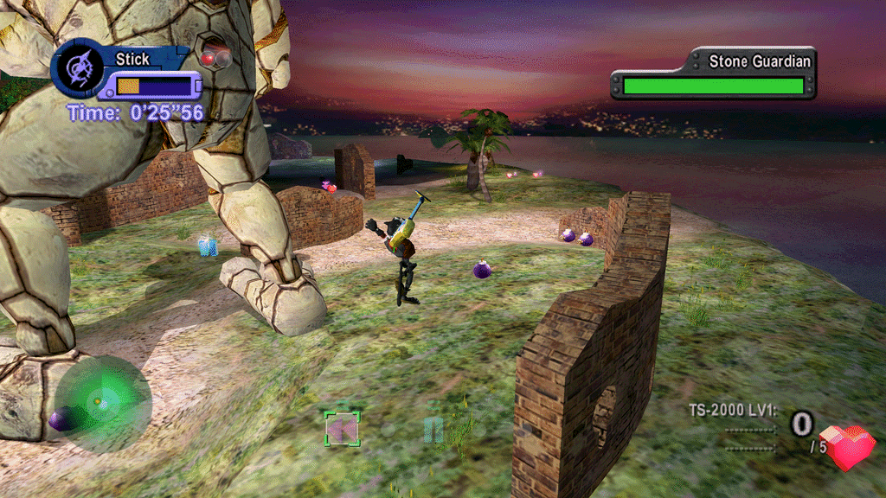

<!-- xbr:readme:download -->
> [!TIP]
> **Get the builder:** download the wizard for your computer from the
> [latest release](https://github.com/apexJCL/blinx2-recomp/releases/latest),
> point it at your own disc image, and it builds and installs the game for you.
>
> | Your computer | Download |
> |---|---|
> | Windows 10 or 11 (x86-64) | `blinx2-wizard-<version>-windows-x64.zip` |
> | Mac (Apple silicon) | `blinx2-wizard-<version>-macos.zip` |
> | Steam Deck or Linux PC | `blinx2-wizard-<version>-linux-x64.tar.gz` |
<!-- /xbr:readme:download -->

**No game is included.** You need your own copy of BLiNX 2; everything the
builder makes from it stays on your machines.

<!-- xbr:readme:release -->
> [!IMPORTANT]
> **Supported game version.** This port is built for one release of
> BLiNX 2 only:
>
> | | |
> |---|---|
> | Title | BLiNX2 |
> | Title ID | `0x4D530065` |
> | Region | region-free |
> | Version | 1 |
> | `default.xbe` sha256 | `0c57fd72053077bc938876d1f2477b937e1f70566500c0e020bb45bbfa4ddc5e` `aa186954c47d9f0a98f8690948e8c43bae15201aa49c3457a42402a142b0c60e` |
>
> The wizard checks your copy on its Dump page before it builds; by hand,
> `./blinx2 fingerprint /path/to/your/disc.iso` says the same. Another
> region or version is **not supported**: it warns "another release", and
> the game may crash or misbehave. A modded copy warns too.
<!-- /xbr:readme:release -->

## How the builder works

<!-- xbr:readme:wizard -->
- Checks your computer and fetches the build tools it needs, each download
  checked against a known checksum. It sends nothing of yours.
- Checks your disc image or game folder, and says before building when it
  is another release or a modded copy.
- Builds an installer for this computer, or for another one: a Windows
  setup program, a Mac app (`.dmg`) or a Steam Deck bundle that adds the
  game to Steam.
- Lets you pick the basic options before building:
  - Render scale
  - Start fullscreen
  - Sharper HUD and menus
- Makes small updates for a device that already has a build, and reuses
  most of the work when you build again.
<!-- /xbr:readme:wizard -->

Step by step, with the SmartScreen and Gatekeeper prompts, and the by-hand
route: [docs/playing.md](docs/playing.md#build-the-game).

## Status

The whole game plays: every stage and boss has been reached in scripted
runs, with sound and saves, and the title, attract mode, stage 1 and the
story route to the hub are checked frame by frame against reference frames
on every build. It runs at 30 frames per second and 4:3, as on the Xbox;
widescreen and a sharper picture are options (below).

| You play on | Graphics | State |
|---|---|---|
| Windows 10 or 11 | Direct3D 11 | Plays with sound and saves. |
| Steam Deck, Linux (Proton) | Direct3D 11 (DXVK) | Plays with sound and saves. |
| Mac (Apple silicon) | Metal | Plays with sound and saves. |

Top known issues (all of them: [docs/playing.md](docs/playing.md#known-issues)):

- On Linux under Proton, resizing the window by hand does not reach the
  game; use fullscreen and the render scale instead.
- A few boss-stage artefacts (sky wedges in Boss 1, shadow shapes in two
  later bosses) are still being checked against the original hardware.
- On a Mac, one scripted run crashed in stage 5-1 after about 90 s; it is
  being investigated.

## Showcase

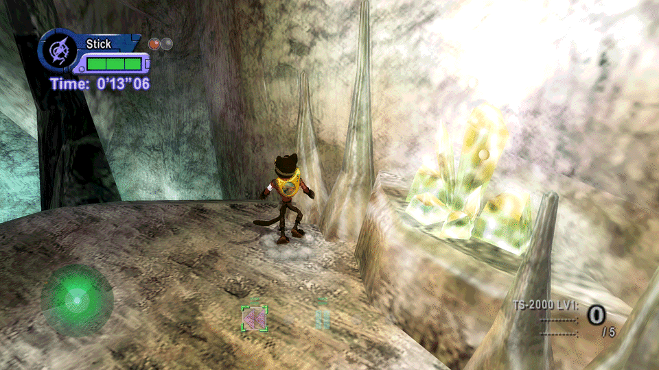

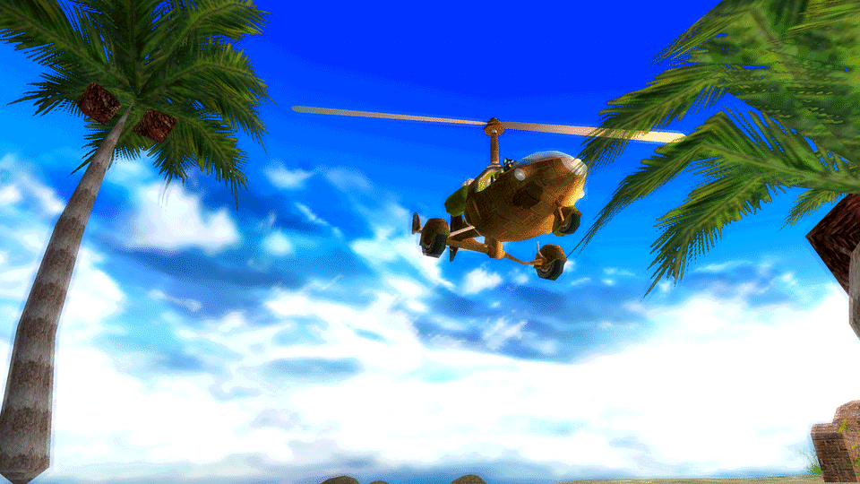

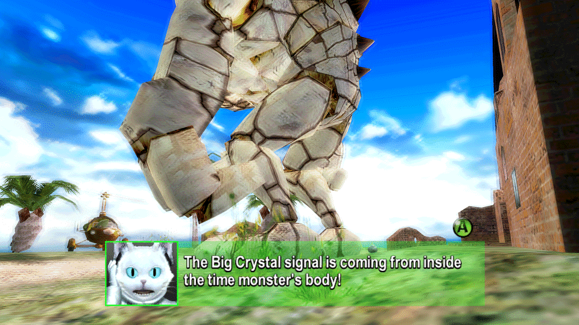

### The in-game menu

F10 on the keyboard (Guide+A or Back+L3 held on a pad) opens a menu over the
game while it keeps running. Its pages: Render (scale, aspect, filtering),
Shaders, Pack (the HUD pack), Game (the game's language), Mods, Stats,
Controls, Saves and Files. Most settings apply at once; Save keeps what you
changed.

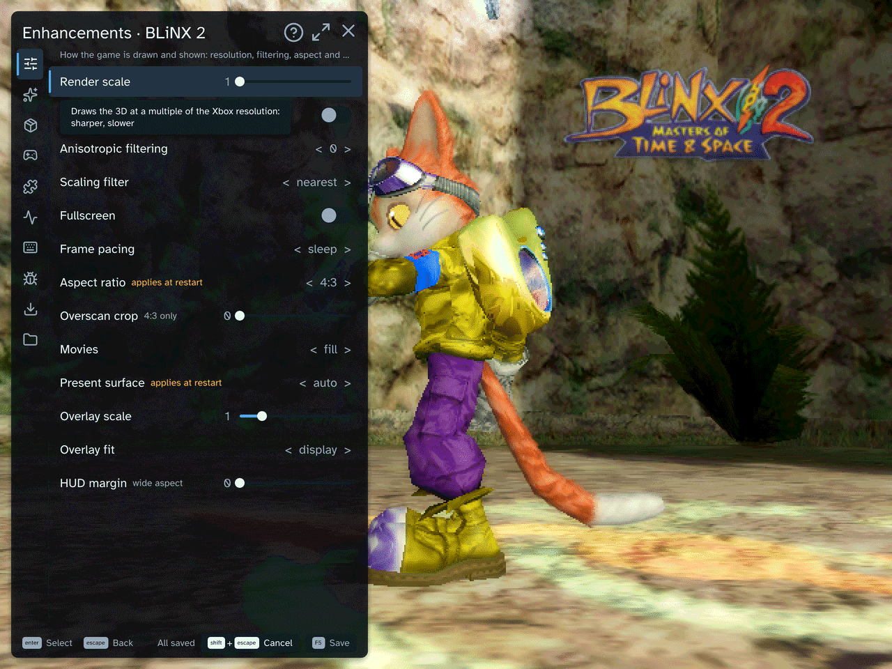

### Mods and enhancements

Every mod is off, or at the Xbox's setting, unless the table says
otherwise. Open the in-game menu, go to the page in the table and change
the option; most apply at once, and Save keeps them for the next start.
The wizard also asks for the render scale and the sharper HUD before it
builds.

| Mod | Menu page | What it does | Default |
|---|---|---|---|
| **Render scale** | Render | Draws the 3D at 1 to 4 times the Xbox's 640x480: sharper, slower. | 1 |
| **Aspect ratio** | Render | Widescreen: 16:9, 16:10 or 21:9 show more of the stage at the sides instead of stretching it (from the next start). | 4:3 |
| **Anisotropic filtering** | Render | Sharper ground and walls seen at a slant: 2, 4, 8 or 16. | 0 |
| **Overscan crop** | Render | Crops the border an old TV hid, and zooms the rest (4:3 only). | 0 |
| **2D on guest grid** | Render | Keeps 2D art on the Xbox's pixel grid at render scale 2 and up, so tiled menus and HUD show no seams. | off |
| **Scaling filter** | Render | How the picture is stretched to the window: nearest is crisp, linear smooth, integer whole multiples only. | nearest |
| **HUD margin** | Render | Pulls the HUD in from the screen edges on a wide picture (0 to 64). | 0 |
| **Profile** | Shaders | A shader over the picture: crt-lottes, crt-lottes-fast or crt-hyllian for an old TV's look, fsr to upscale. | Off |
| **Texture pack** | Pack | The HUD, the menus and the font redrawn at four times the Xbox's size, from your own game files. | on, once the pack is built |
| **HUD at the screen edges** | Mods | On a wide screen, the radar, the time panel and the counters move out to the edges. | on |
| **Bloom** | Mods | The game's soft glow over bright parts of the picture: on or off, and how strong (0 to 2). | on, 1 |
| **Character detail** | Mods | At render scale 2 and up, characters keep their detailed models as far away as at the Xbox's resolution. | off |
| **Free camera** | Mods | Fly a camera anywhere in the stage, stop the world and hide the HUD, for your own screenshots. | off |
| **BLiNX 1 crystals** | Mods | Collect crystals the BLiNX 1 way: a row of four, where three of one colour give that time control. | off |
| **Full Diagonal Movement** | Mods | Diagonals run up to 1.69 times as fast as straight, as in BLiNX 1. | off |
| **Speed readout** | Mods | Shows Blinx's run speed on screen; a debug readout for the mod above. | off |
| **Enemies** | Mods | Spawn a copy of the nearest enemy, defeat the nearest one, and raise enemy hp. | off |
| **Shop** | Mods | Change the shop's prices and the guns' ammo, power, shot speed and fire rate. | off |
| **Walls** | Mods | Thin-wall fix, experimental: meant to stop Blinx sliding through thin walls. | off |
| **Collision** | Mods | A debug view: the stage's collision triangles drawn around Blinx. | off |
| **Debug menu** | Mods | The developers' own debug menu and stage select, opened at the title's PRESS START. | off |
| **Language** | Game | The language the game is told the console is set to: en, ja, de, fr, es or it (from the next start). | en |

The pictures below are the same shot of the same scripted run through
stage 3, run once per setting, so only the setting differs: the stock
setting on the left, the mod's on the right. The water and the timer move a
little between runs. Render scale, aspect, shader, texture pack and bloom
were taken on the 2026.11.2 build with Direct3D 11 on Windows; the others on
a Mac with Metal.

#### Render scale

The Xbox drew every game at 640x480. Render scale 3 draws the 3D at
1920x1440; the wizard asks for it, and Render > Render scale changes it
while you play.

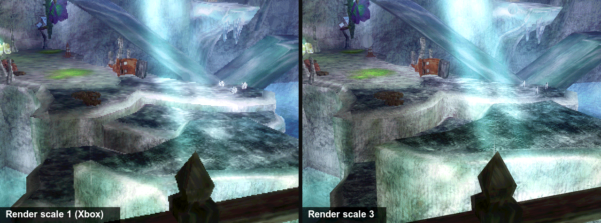

#### Aspect ratio

Render > Aspect ratio > 16:9 keeps the game's height of view and shows more
of the stage at the sides; menus and dialogue stay centred, and the movies
fill the width. It takes effect at the next start.

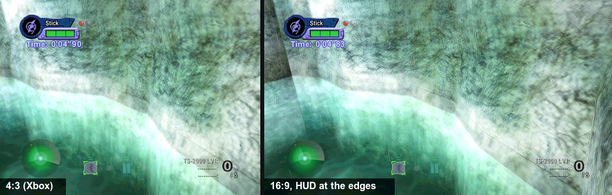

#### Anisotropic filtering

Render > Anisotropic filtering > 16 keeps the ground's texture sharp as it
runs away from the camera. A small change in this game, easiest to see at
render scale 1.

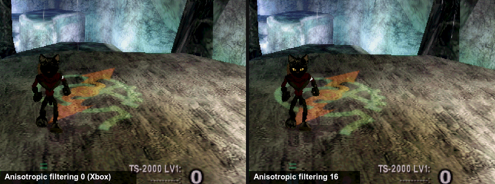

#### Overscan crop

A still shows only a zoom. Its origin: a 2004 TV hid a band around the
picture, so console games kept their HUD away from the border, and some
left junk there. Overscan crop cuts that band and fills the window with the
rest. BLiNX 2 draws a clean border and needs none.

#### 2D on guest grid

Above render scale 1 the 3D gets sharper, but 2D art made of tiles (menus,
the HUD, fonts) can show thin seams where the tiles meet, because each tile
now samples between the Xbox's pixels. This keeps 2D on the Xbox's own
pixel grid, as at scale 1: no seams, blockier 2D art.

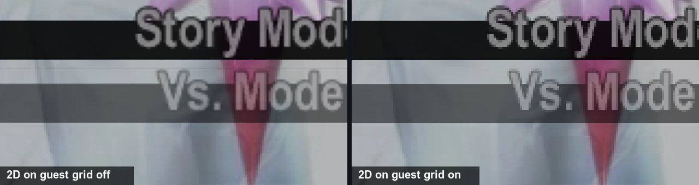

#### Scaling filter

The Xbox drew for a TV; a window is larger, so the picture is stretched to
fit. Nearest keeps every pixel sharp, linear blends them for a softer
picture, and integer scales by whole multiples only, with a border, so
every pixel is the same size.

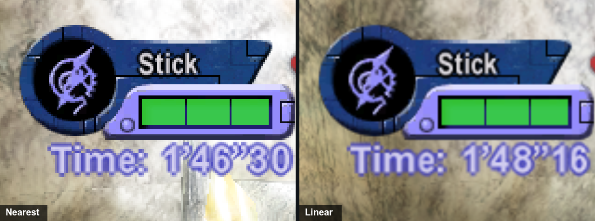

#### HUD margin

With HUD at the screen edges on a wide picture, the HUD sits at the very
edge of the screen. HUD margin pulls it back in, in steps of 4 of the
Xbox's pixels, for a TV that crops its border or for a picture that reads
better nearer the middle.

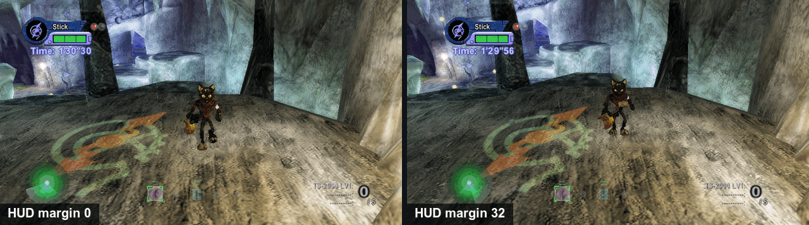

#### Profile

Shaders > Profile > crt-lottes draws the picture like an old TV, with
scanlines and a shadow mask; crt-hyllian is another look, and fsr is AMD's
upscaler instead. The Shaders page tunes each one, and saves a chain of
them as a profile of your own.

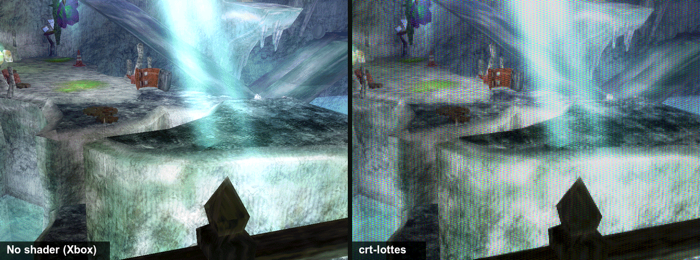

#### Texture pack

The wizard's "Sharper HUD and menus" option redraws the HUD, the menus and
the dialogue font at four times the Xbox's size, from your own game files
(on Windows and Linux it needs the free PT Sans Narrow Bold font installed
first). Pack > Texture pack turns it off for a session. By hand:
[the HUD texture pack](docs/playing.md#hud-texture-pack). A pack of every
texture, the 3D world included, is
[built by hand](docs/packaging.md#your-whole-game-texture-pack) (with CLI
0.22 or later, the next pin move).

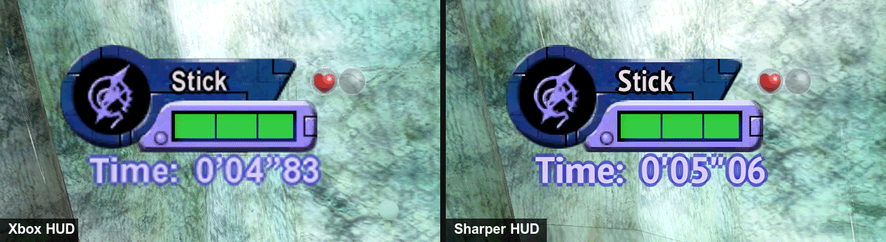

#### HUD at the screen edges

The game placed its HUD for a 4:3 TV. On a wide screen, Mods > HUD at the
screen edges keeps the radar, the time panel and the counters at the
edges; off, they stay where they were in the middle 4:3 of the picture.
It does nothing at 4:3.

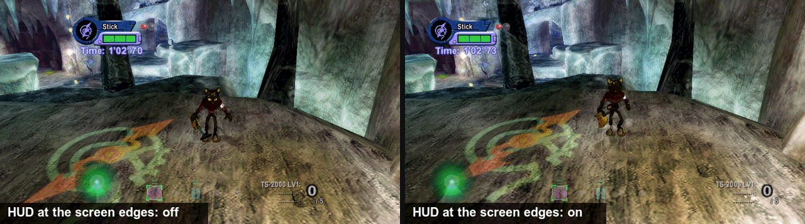

#### Bloom

Mods > Bloom > off draws the picture without the game's soft glow; Bloom
intensity makes it weaker (towards 0) or stronger (up to 2).

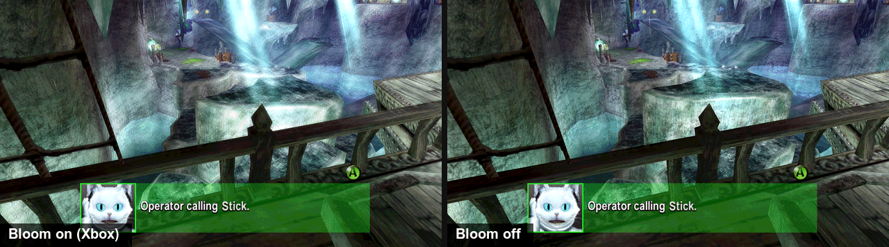

#### Character detail

The game swaps characters to simpler models by how big they are on a
480-line screen. At a higher render scale they are drawn sharper, so the
swap shows: goggles, gloves, boots and shadows go plain at a distance.
Mods > Character detail keeps the detailed models as far as they reached at
the Xbox's resolution. It costs some speed.

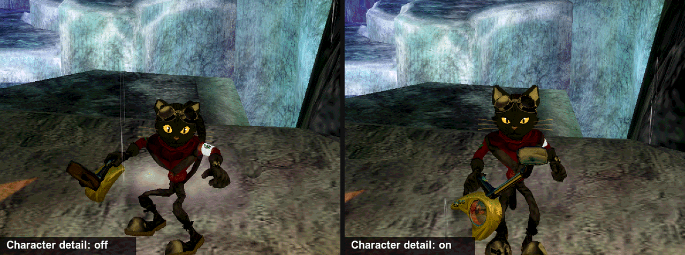

#### Free camera

F6 (Guide+Y, or Back+R3 held on a pad) detaches the camera from Blinx and
flies it anywhere in the stage; End stops the world and F7 hides the HUD.
Its origin: the game's own camera follows Blinx on a fixed path, and this
was made for screenshots and for looking at a stage from where the game
never shows it. Controls: [docs/playing.md](docs/playing.md#free-camera).

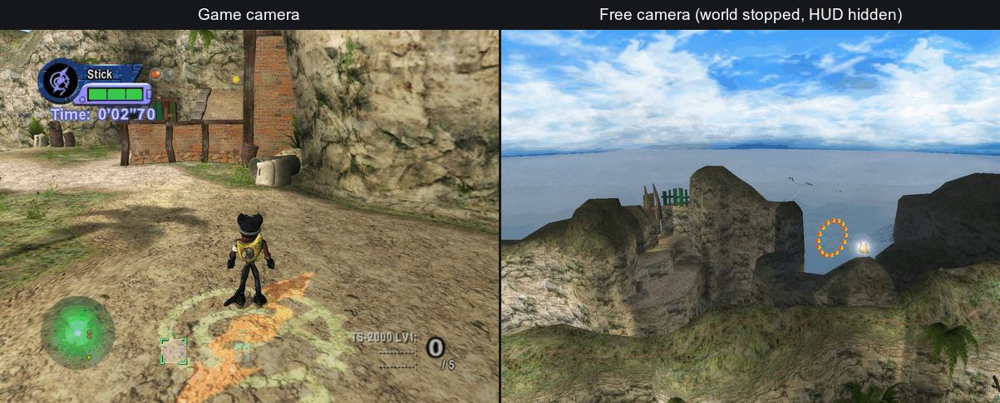

#### BLiNX 1 crystals

No picture: it changes how crystals count. In BLiNX 1, crystals filled a
row of four in the order you picked them up: three of one colour gave
that time control, four gave it twice, and the row emptied at four. BLiNX 2
changed that; this mod brings the first game's rule back, in the Sweepers
stages. Controls still go to the d-pad with the game's limits, and a full
control pays gold.

#### Full Diagonal Movement

No picture: it changes speed. In BLiNX 1, a diagonal on the keyboard or on
a stick with a square gate ran up to 1.69 times as fast as straight. BLiNX 2
caps diagonals at straight speed; this mod lifts the cap. Pads and the
keyboard also need Controls > Sticks > Square left stick, so a diagonal
reaches the corner.

#### Speed readout

A small card with Blinx's run speed: 1.00 at a full straight push, up to
1.69 on a diagonal with Full Diagonal Movement, and the peak of about the
last second. It was made to measure that mod.

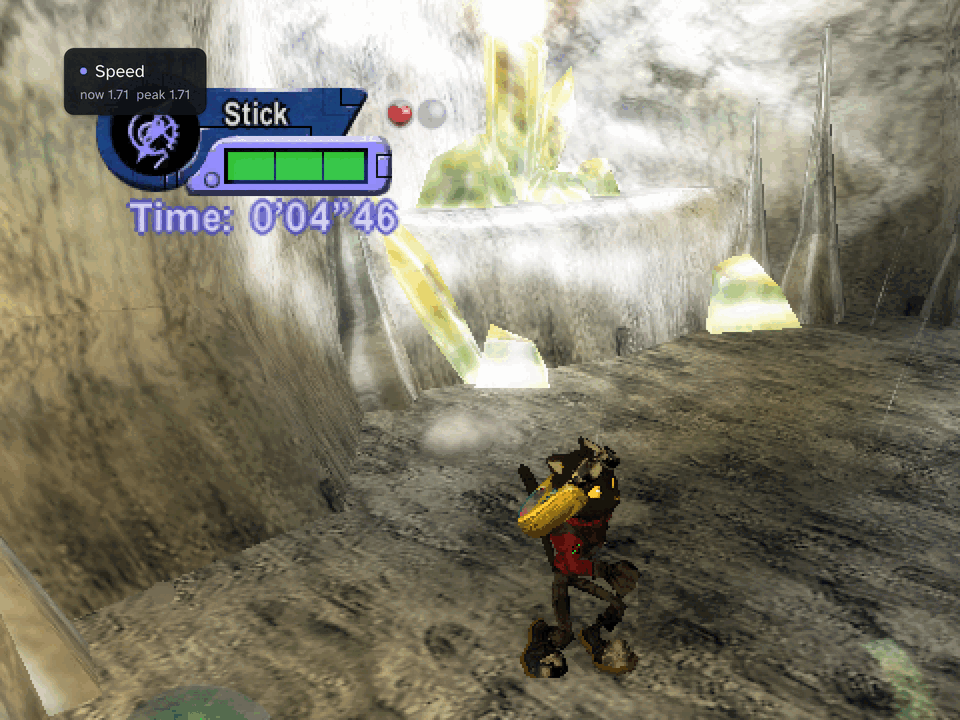

#### Enemies

No picture: it adds actions. Spawn a copy of the nearest enemy, defeat the
nearest one through the game's own damage, or raise the hp of the game's
first enemy type, from the mod's page or a key you bind. It was made as
the first user of the port's enemy interface for mods, and shows what one
can do; it is not in VS mode.

#### Shop

No picture: it changes numbers. Prices, and every gun's ammo, power, shot
speed and fire rate, as a percentage of the game's. Like Enemies, it was
made on the port's shop interface for mods. Off puts the game's values
back; nothing of it is saved, and what you bought stays yours.

#### Walls

Experimental: in a wall thinner than Blinx's collision sphere, the game
can push him out by the far face, so he slides through, and this mod
pushes him back out by the side he went in. Only a probe of the game's
triangle test shows the slide so far; nobody has reproduced it in play.

#### Collision

A debug view: it draws the stage's collision triangles around Blinx, by
the class the game tests them as, and changes nothing the game does. It
was made to check the Walls fix against the game's own data.

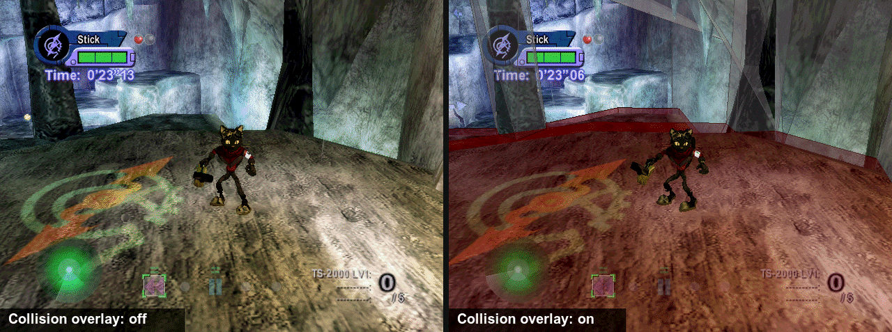

#### Debug menu

The developers left their debug menu and stage select in the disc. Turn
the mod on, then open the menu from the mod's page at the title's PRESS
START. The few entries that hang on the loading screen (MODEL_EDIT,
GARAGE, ENDING, THEATER) are left out.

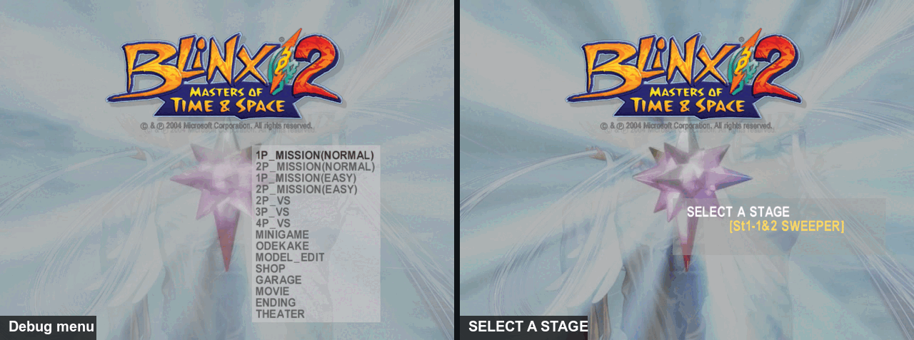

#### Language

The Xbox told a game which language the console's dashboard was set to,
and BLiNX 2 carries six on the disc. Game > Language picks one; the game
reads it at the next start.

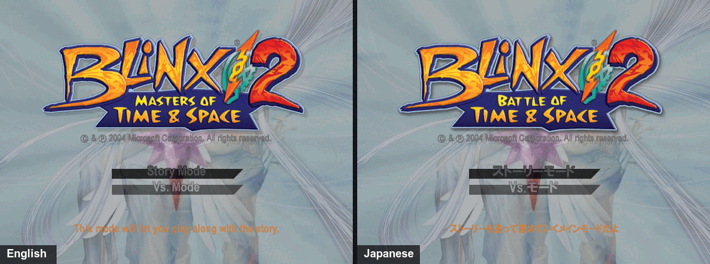

All the options, the by-hand settings file and the controls:
[docs/playing.md](docs/playing.md#options).

## Build requirements and common gotchas

- About 15 GB free for the build, plus room for the installer.
- A Windows 10 or 11 PC, an Apple silicon Mac, or a Steam Deck or Linux PC
  (in Desktop Mode on the Deck).
- An internet connection for the first build (the tools download once).
- Your copy is the supported version (the box above).

The failures players hit most:

- **"Files are missing", or music, voices or a movie are missing:** the
  disc image is incomplete. Dump it again and build again; the game's log
  names each missing file.
- **Mac: "the app is damaged" or cannot be opened:** that is Gatekeeper.
  Right-click the app and pick Open, once.
- **Steam Deck: the first launch shows only a notice for a few minutes:**
  it is downloading Proton; the notice closes when the game starts.

The rest: [docs/playing.md](docs/playing.md#troubleshooting).

## Report a bug

[Open a bug report](https://github.com/apexJCL/blinx2-recomp/issues/new?template=bug_report.yml):
the form asks for what we need (your game version, the build version, where
you play, your settings and the logs). Never attach game files, a disc
image, a save or a built bundle.

## More documentation

| Document | For |
|---|---|
| [docs/playing.md](docs/playing.md) | building by hand, installing, controls, saves, every option, the HUD texture pack, known issues, troubleshooting |
| [docs/developers.md](docs/developers.md) | how the port works, building from source, the toolchain, testing, environment variables, contributing |

**Sister project.** [Burnout 3: Takedown](https://github.com/apexJCL/burnout3-recomp)
is recompiled with the same toolkit and build wizard.

## Legal

This repository contains **no game data and no game code**:

- no game files, assets or saves;
- no lifted (recompiled) game code. `src/recomp/gen/` is generated on your
  machine by the pipeline and is never committed.

To build it you need your own legally obtained copy of BLiNX 2. BLiNX 2 and
its assets belong to their respective owners; this project is not affiliated
with them. A bundle made by `blinx2 package` contains your copy of the game
and code generated from it: it is for your own machines only, and is not
yours to redistribute. The same goes for a HUD texture pack made by
`blinx2 enhance hud`: it is built from your game files.

### License and credits

MIT, see [LICENSE](LICENSE). Parts of `src/main.c`, `src/recomp_manual.c` and
`CMakeLists.txt` started from xboxrecomp's MIT-licensed new-game templates; the
license file carries that notice too.

The toolkit that the build links in statically carries LGPL-2.1 APU code
extracted from xemu. If you distribute a built binary, read [NOTICE](NOTICE)
first.

Built on [xboxrecomp](https://github.com/sp00nznet/xboxrecomp) by sp00nznet.
The HUD pack's Latin font is redrawn from PT Sans Narrow Bold (ParaType,
OFL 1.1), which you install yourself; it is never vendored.
