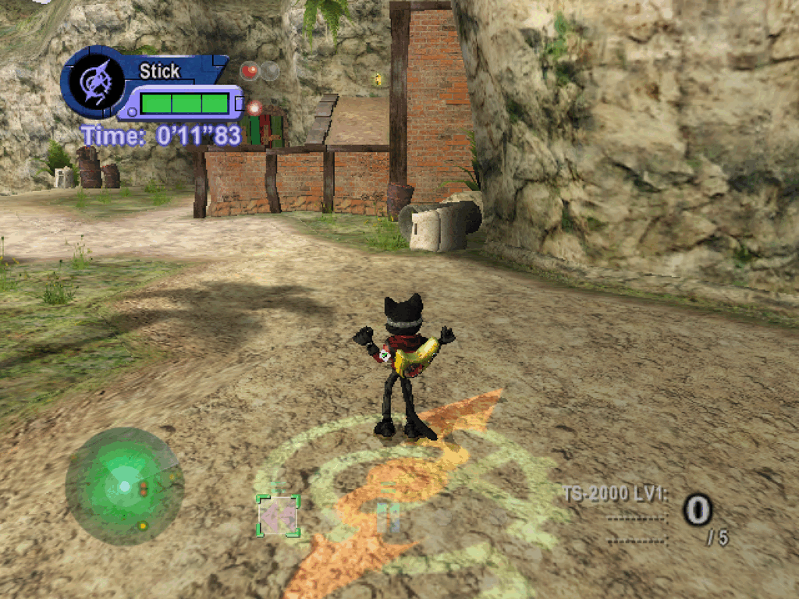
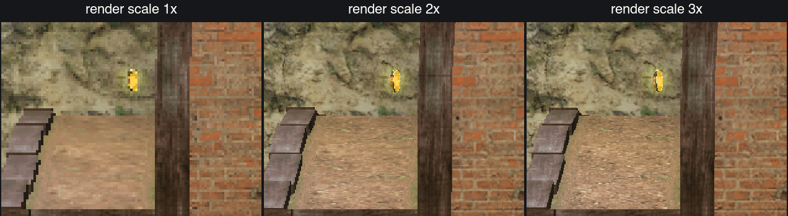
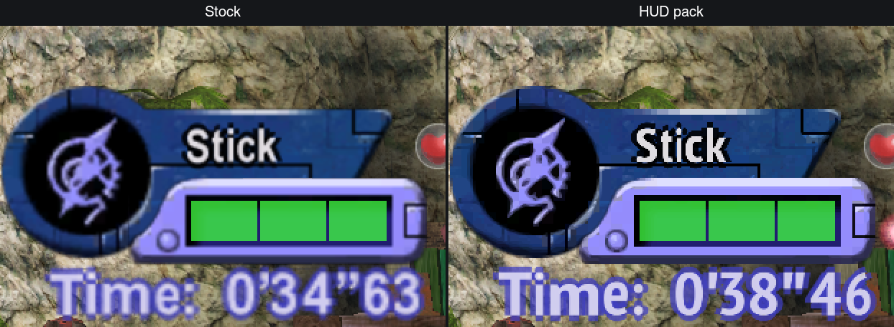
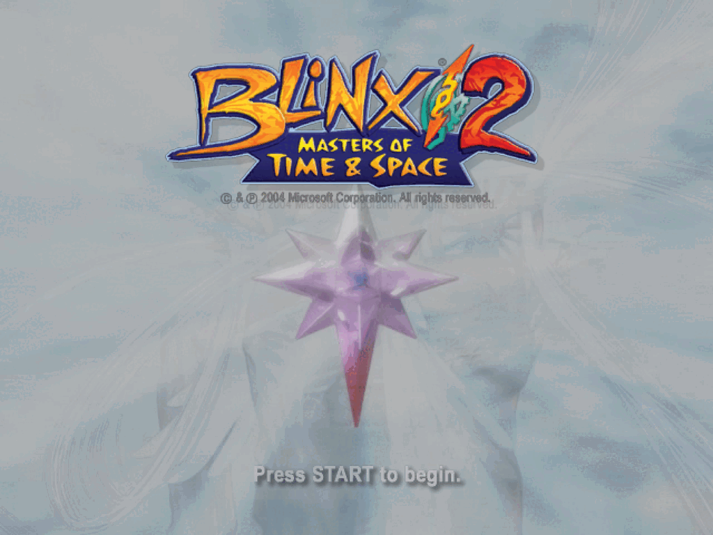
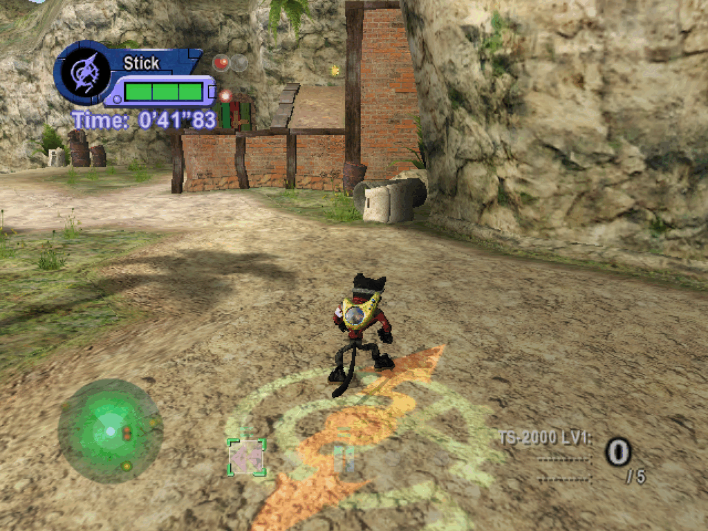
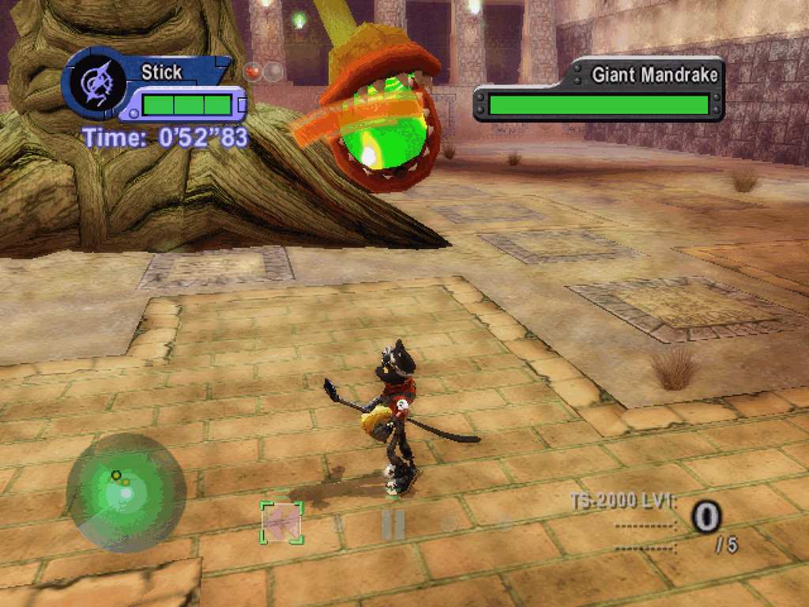

# BLiNX 2 static recompilation

*BLiNX 2: Masters of Time & Space* was an original Xbox game. This project
turns your own copy of it into a native program for your PC or Mac: the game's
x86 code is lifted to C by the [xboxrecomp](https://github.com/apexJCL/xboxrecomp)
toolkit and compiled together with a replacement Xbox kernel, GPU (NV2A) and
audio (APU) runtime. No emulator, no disc in a drive: one command builds a
private, installable bundle from your disc dump.

**No game data is included or distributed.** You need your own copy of the
game; everything built from it stays on your own machines.



<!-- TODO(link): releases page, once a release exists -->
<!-- TODO(link): demo video -->

**Contents:** [For players](#for-players) (what you need, platforms, install,
options, HUD texture pack, known issues, screenshots, help) |
[For developers](#for-developers) (architecture, build from source, the
toolchain, testing, environment variables, docs, contributing, legal).

---

# For players

## What you need

| Item | Why |
|---|---|
| Your own, legally obtained copy of BLiNX 2: a disc image (`.iso`) or the extracted folder with `default.xbe` | The game's code and assets come from it. This project does not provide or link to them, and refuses other titles. |
| A build machine: a Mac (Apple silicon), a Linux PC or a Windows PC, with about 15 GB free | The bundle is built from your dump on your machine. A Mac can build every target; Linux and Windows build the Windows and SteamOS bundles. |
| [uv](https://docs.astral.sh/uv/getting-started/installation/), git and Python 3.9 or newer | `./blinx2` fetches everything else (CMake, Ninja, the compiler, the toolkit), each download checked against a pinned sha256; it uses git to fetch the toolchain. **macOS:** `brew install uv`; git and Python come with the Command Line Tools (`xcode-select --install`). **Linux:** `curl -LsSf https://astral.sh/uv/install.sh \| sh`; git and Python from your distribution. **Windows:** `winget install --id=astral-sh.uv -e` (uv only), [Git for Windows](https://git-scm.com/download/win), and Python 3.9 or newer from [python.org](https://www.python.org/downloads/windows/) with the `py` launcher. |
| A controller, or the keyboard | Any Xbox, PlayStation or other SDL-supported pad is player 1; the keyboard works too. |

## Platforms

| You play on | Bundle | Graphics | Audio | Input | Status |
|---|---|---|---|---|---|
| Steam Deck (stock SteamOS), or a Linux gaming PC | `steamos` (the Windows build, run under Proton through `umu-run`) | Direct3D 11 (DXVK) | XAudio2 (FAudio) | Controller (XInput) and keyboard | Plays with sound and saves. The Deck is the regular manual test machine. The game is 4:3 only (widescreen is not done yet): on the Deck set the Steam entry's Game Resolution to Native (1280x800) so Steam does not rescale it, then set `scale = 2`, or leave it at 1 and rely on FSR. |
| Linux desktop with Proton | `steamos`, or the bare build under `umu-run` | Direct3D 11 (DXVK) | XAudio2 (FAudio) | Controller and keyboard | Plays; this is the tested Linux route (GE-Proton 11). Window resize does not reach the game there; fullscreen does. |
| macOS (Apple silicon) | `macos` (`.dmg`) | Metal | SDL2 (CoreAudio) | Controller (SDL GameController) and keyboard | Plays with sound and saves. |
| Windows x86-64 | `windows` (a setup program) | Direct3D 11 | XAudio2 | Controller (XInput) and keyboard | Builds and installs, but **untested on native Windows**: the setup program and the game have only been run under Proton. |

The game runs at 30 frames per second and 4:3, as on the Xbox. A 60 fps mode
is not planned (the stage logic steps a fixed 1/30 s, so a faster loop plays
at double speed), and widescreen (Hor+) is not implemented yet: a wide window
or screen is pillarboxed, never stretched.

Every stage and boss has been reached in scripted runs; the title, attract
mode, stage 1 and the story route to the hub are checked frame by frame
against reference frames on every build, on Metal and on Direct3D 11.

**Sister project.** [Burnout 3: Takedown](https://github.com/apexJCL/burnout3-recomp)
is recompiled with the same toolkit and build wizard, as a fork of
[sp00nz's project](https://github.com/sp00nznet/burnout3); its README has its
own platforms table and [releases](https://github.com/apexJCL/burnout3-recomp/releases),
so you can compare how far each game has come. Neither repository publishes
game files, frames, audio or saves.

## Build the game

**The short route: the build wizard.** From the release that carries it on,
each [release](https://github.com/apexJCL/blinx2-recomp/releases) has a
small program for Windows, macOS and Linux (Steam Deck included): download
yours, point it at your disc image, pick the options, and it builds and
installs the game for you. It runs the same commands as below.
[docs/packaging.md](docs/packaging.md#the-wizard) has the steps, the
SmartScreen and Gatekeeper prompts, and where it puts things.

**By hand.** Get this project, then go into its folder (one line at a time, in Terminal
on macOS and Linux or in PowerShell on Windows):

```sh
git clone https://github.com/apexJCL/blinx2-recomp.git
cd blinx2-recomp
```

Then give it your disc image, or the folder with `default.xbe`:

```sh
./blinx2 /path/to/your/BLiNX2.iso
```

In PowerShell that is `.\blinx2 C:\path\to\BLiNX2.iso` (`blinx2
C:\path\to\BLiNX2.iso` in the Command Prompt). On Windows, keep the path
short (`C:\b2`) and run `git config --global core.longpaths true` once
before the clone.

It checks that the disc is BLiNX 2, puts its files in `game_files/` in this
folder (git ignores it), fetches the toolchain, lifts the game and builds a
bundle for this computer: macos on a Mac, steamos on Linux, windows on
Windows. The first run takes a while (between about 20 and 40 minutes in the
runs timed so far); later runs only rebuild what changed. The bundle lands in
`dist/`. You can also copy the disc's files into `game_files/` yourself and
run `./blinx2` alone.

```sh
./blinx2 package windows|steamos|macos   # the same, for another target
./blinx2 doctor      # what this machine has, what it can package, and what to install first
```

Copy the bundle to the machine you play on (a USB stick, `scp`, a share) and
install it there:

| Target | Install | Saves, settings and logs |
|---|---|---|
| **Steam Deck / Linux** (`dist/BLiNX2-<v>-steamos.tar`) | In Desktop Mode: `tar -xf BLiNX2-<v>-steamos.tar`, `cd BLiNX2-<v>-steamos`, `./install.sh --steam` (Steam open: it adds "BLiNX2" as a non-Steam game). A stock Deck has no `umu-run`; the installer offers to download the pinned umu-launcher (1.4.4), or run `./install.sh --fetch-umu`. The first launch downloads the Steam Linux Runtime and GE-Proton and makes the Wine prefix, which takes a few minutes. In Game Mode, set the entry's Properties > General > Game Resolution to Native (1280x800). Later versions: `./install.sh`; `./install.sh rollback` goes back one. | `~/Games/BLiNX2/{hdd,config,logs}` |
| **macOS** (`dist/BLiNX2-<v>.dmg`) | Open the `.dmg` and drag `BLiNX2.app` to Applications (replace the old one to update). The app is signed ad hoc, not notarized: on another Mac, right-click > Open once, or `xattr -dr com.apple.quarantine /Applications/BLiNX2.app`. | `~/Library/Application Support/BLiNX2/{hdd,config,logs}` |
| **Windows** (`dist/BLiNX2-<v>-windows/`) | Keep the folder together (the setup reads `game_files\` beside it) and run `BLiNX2-<v>-setup.exe`. It installs for your user only, no administrator rights, with a Start Menu entry. SmartScreen will warn (unsigned, built on your machine): More info > Run anyway. A newer setup installs on top. | `%LOCALAPPDATA%\BLiNX2\{hdd,config,logs}` |

Saves (`hdd/`), settings (`config/`) and logs (`logs/`) live outside the
program files and survive every update, rollback and uninstall.
[docs/packaging.md](docs/packaging.md) has the long version: every installer
option, updating, uninstalling, moving saves and a troubleshooting list.

**A bundle is private.** It contains your copy of the game and code generated
from it. Keep it on your own machines; never share, upload or publish it.

### Controls

A controller is player 1. The keyboard and the mouse are merged onto
player 1 while the game window has the focus. Focusing the window grabs the
mouse; `F9` frees the cursor and grabs it again. Change a key under
`[input.bindings]` in `config/config.toml`; [docs/input.md](docs/input.md)
has the names, examples and the mouse settings.

| Keys and mouse | Xbox control | Keys and mouse | Xbox control |
|---|---|---|---|
| W/S/A/D (or numpad 8/2/4/6) | Left stick (move) | Mouse, or I/K/J/L | Right stick (look) |
| Arrows | D-pad | Space | A (jump) |
| Left click or R | Right trigger (sweep, shoot) | Right click or F | B (action) |
| E | X (time control) | Q | Y |
| C, Z | White, Black | Left Shift | Left trigger |
| Tab, middle click | Left, right stick click | | |
| Enter or Escape | START (pause) | Backspace | BACK |
| Left Alt (hold) | walk | F9 | free the cursor |

## Options

The game runs stock by default. Enhancements are opt-in. Every option and
its default is in `config.default.toml`, which ships beside the game (in
`Contents/Resources` in the macOS app) and is replaced by each update. Your
changes go in `config/config.toml` in the data folder above: it holds only
the keys you set, wins over the defaults, and no update touches it (the
first launch writes it as a comment header, and renames a
`config/enhance.toml` from an earlier version). Each key can also be set as
an environment variable, which wins over both files; `config/launch.env`
takes `KEY=value` lines for any `RECOMP_*` variable.

| Option | `config.toml` key | Environment variable | Values (default first) | What it does |
|---|---|---|---|---|
| Render scale | `render.scale` | `RECOMP_RENDER_SCALE` | `1`, `2`, `3`, `4` | Draws the 3D at a multiple of the stock 640x480. Metal and Direct3D 11; the CPU renderer ignores it. |
| Fullscreen | `present.fullscreen` | `RECOMP_PRESENT_FULLSCREEN` | `false`, `true` | Opens the window borderless fullscreen (no mode change). |
| Scaling filter | `present.filter` | `RECOMP_PRESENT_FILTER` | `"nearest"`, `"linear"`, `"integer"` | How the 4:3 frame fills the window: letterboxed nearest, letterboxed bilinear, or the largest whole multiple that fits, centred. |
| Frame pacing | `present.pacing` | `RECOMP_PRESENT_PACING` | `"sleep"`, `"spin"` | `sleep` lets the game's frame wait sleep until the next vblank: less heat and battery on a laptop or a Deck, the same frames. `spin` is the console-original timing, where the wait holds a CPU core as it did on the Xbox. |
| HUD texture pack | `textures.pack` | `RECOMP_TEXTURES_PACK` | none, a path | Your own 4x HUD and font pack, see [below](#hud-texture-pack). A relative path is taken from the executable's folder. |
| Glow | `fx.glow`, `fx.glow_intensity` | `RECOMP_GLOW`, `RECOMP_GLOW_INTENSITY` | `"on"`/`"off"`; `1.0` (0.0 to 2.0) | Turns the game's screen glow pass off, or scales it. |
| Window size | (none) | `RECOMP_WINDOW_SCALE` | `2` | Initial window size, 640x480 times this (the SDL window on macOS). |
| Aspect | `display.aspect` | `RECOMP_DISPLAY_ASPECT` | `"4:3"` only | Other values are reported as not implemented and 4:3 is used. |
| Frame rate | `fps.mode` | `RECOMP_FPS_MODE` | `"lock30"` only | `lock60` and `free` are reported as not available (see [Platforms](#platforms)). |

```toml
# config/config.toml, for example
[render]
scale = 2

[present]
fullscreen = true
pacing = "spin"

[fx]
glow = "off"
```

Render scale at 1x, 2x and 3x on the same detail of stage 1 (Metal, in a
window at twice the stock size; stock behaviour and the automated checks stay
at 1x):



## HUD texture pack

At render scale 2 or 3 the 3D is sharp, but the HUD, menus and font are
still the game's own small textures, stretched. A HUD texture pack replaces
them with versions at 4x: an xBR upscale of the HUD art, and the Latin font
redrawn from PT Sans Narrow Bold, glyph by glyph in the stock layout. The
Mission Objectives screen's pre-rendered text is in the pack too; the
mission summary (results) text and languages other than US English are not
yet, and stay stock. The pair shows the same stage 1 HUD without and with
the pack, from the Metal backend at render scale 2 in a window at twice the
stock size (1:1 crops; the timers differ because they are two runs).



The pack is optional and off by default. No pack is distributed: you make
your own from your own game files, and it stays on your machines like the
game. On Linux and Windows install PT Sans Narrow (ParaType; a Google Fonts
family) for your user first; macOS ships it. Build the game first
(`./blinx2 /path/to/your/BLiNX2.iso`, above), then make the pack and package
with it:

```sh
./blinx2 enhance hud                   # writes dist/enhance/hud/hud.pack (--font FILE for another font file)
./blinx2 package macos --hud-pack      # or windows, steamos: puts the pack in the bundle and turns it on
```

`--hud-pack` turns the pack on in the bundle's `config.default.toml`, so
it is on after a first install and after an upgrade alike. For the stock
HUD, put this in your `config/config.toml`:

```toml
[textures]
pack = "none"
```

At start the log says `[ENHANCE] textures.pack=<path> (<n> entries, scale
4)`, and every 600 flips `[metal] textures.pack: N hits so far` (`[d3d11]`
on Direct3D 11) counts the textures drawn from the pack. Metal and
Direct3D 11 draw the pack; the CPU renderer ignores it, and the automated
checks never use one. `./blinx2 enhance hud --help` lists the options
(`--scale 2|4`, `--only PATTERN`, `--list`).

## Known issues

| Issue | Where | State |
|---|---|---|
| The game can crash in stage 5-1 after about 90 s (seen once, in a scripted run) | macOS | Being investigated. |
| Resizing the window by hand does not reach the game | Linux/Proton (GE-Proton 11, KWin) | Fullscreen and render scale work; use them instead. |
| Bump-environment mapping (the stage 1 ocean, the Boss 3 ripple) draws as a plain texture | All | Not implemented yet. |
| User clip planes are only honoured by the CPU renderer | Metal, Direct3D 11 | Not implemented yet on the GPU backends. |
| A few boss-stage artefacts: sky wedges in Boss 1, shadow shapes in two later bosses | All backends alike | Still being checked against the original hardware; they may be the game's own. |
| Movies: audio-to-video drift has not been measured | All | The game's own Sofdec decoder plays them. |
| Native Windows | Windows | The build is tested under Proton only. |

Fixed in current builds, and verified on the Steam Deck: the freeze on the
results screen after mission 1 and after the mission 3 boss, dark ground and
water on multi-core PCs, and the stage 1 wading stutter.

Quick fixes for the usual symptoms:

| Symptom | Fix |
|---|---|
| "Files are missing", or music, voices or a movie are missing, or the game says the disc is dirty | Your `game_files/` is incomplete: the game's log names each missing file on a `[FILE] missing` line. Import the disc again with `./blinx2 import /path/to/BLiNX2.iso --replace` (`import --check` lists what differs first), then rebuild with `./blinx2`. |
| No sound | Audio is on by default. Check that `config/launch.env` does not set `RECOMP_AC97_READY=0`, and that `SDL_AUDIODRIVER` is not `dummy`. |
| The keyboard does nothing | The game window must have the focus, `input.keyboard` must not be `false` in `config/config.toml`, and `RECOMP_KEYBOARD` must not be `0`. |
| The mouse does nothing | Click in the game window or focus it to grab the cursor (`input.mouse_capture`), or press `F9` if you freed it; `input.mouse` must not be `false` and `RECOMP_MOUSE` must not be `0`. |
| Steam Deck: "umu-run is not installed" | In Desktop Mode, run `./install.sh --fetch-umu` from the unpacked bundle. |
| Steam Deck: the first launch shows only a notice for a few minutes | It is downloading the runtime and Proton; `~/Games/BLiNX2/logs/umu.log` shows the progress. The notice closes when the game starts. |
| macOS: "the app is damaged" or cannot be opened | Gatekeeper: right-click > Open once, or `xattr -dr com.apple.quarantine /Applications/BLiNX2.app`. |

## Screenshots







<!-- TODO(screenshot): second boss fight or time-control effect -->
<!-- TODO(screenshot): attract mode -->
<!-- TODO(gif): short gameplay clip -->

## Getting help

Open an issue on this repository. Say which platform and bundle version you
run (the version is in the bundle's name and in `logs/`), what you did, and
attach the newest `logs/game-*.log` from the data folder in the
[install table](#build-the-game). Never attach your game files, a save or
the bundle itself.

If the game crashes or does not start:

1. Note what you saw: an error box (its text or a screenshot), the window
   closing, or nothing at all. Add your GPU, its driver version and your
   OS version.
2. Attach the newest `logs/game-*.log` and `logs/xbox_kernel.log` from the
   data folder. The kernel log is rewritten on every launch, so copy it
   before starting the game again. An empty `logs/` is worth saying too.
3. Attach the system's crash record:
   - Windows: in PowerShell, run
     `Get-WinEvent -FilterHashtable @{LogName='Application'; ProviderName='Application Error'} -MaxEvents 3 | Format-List TimeCreated,Message`
     and paste what it prints.
   - macOS: the newest `cat_recomp-*.ips` in `~/Library/Logs/DiagnosticReports/`.
   - Steam Deck or Linux: also `logs/umu.log`.
4. If asked, run once more with extra logging: put these two lines in
   `config/launch.env` in the data folder (on Windows, check the file does
   not end in `.txt`), start the game the usual way and attach the new
   `game-*.log` and `xbox_kernel.log`.
   ```ini
   RECOMP_LOG_LEVEL=3
   RECOMP_TRACE=missing=all,flip,stub
   ```
   They only add log lines; delete the file afterwards.

[docs/packaging.md](docs/packaging.md#reporting-a-crash) has the details.

---

# For developers

## Architecture

```
game_files/default.xbe
   │  blinx2 analyze      parse the XBE, disassemble, find functions, recover ABIs   (xbr, xboxrecomp-cli)
   │  blinx2 recomp       lift x86 to C                                             (xboxrecomp tools)
   ▼
src/recomp/gen/*.c       the lifted game (generated on your machine, never committed)
   +  src/                this game's boot code, hand-written XDK replacements, pad input, save seeding
   +  xboxrecomp runtime  replacement Xbox kernel, NV2A pushbuffer executor (Metal, D3D11, CPU), APU audio
   │  blinx2 build        CMake + Ninja; llvm-mingw cross-compiles the Windows build on every host
   ▼
build/cat_recomp (macOS) or build-win/cat_recomp.exe (Windows, Proton)
   │  blinx2 package      a private bundle: macOS .dmg, Windows setup program, SteamOS tar with installer
   ▼
dist/
```

This repository holds the game-specific half: the boot code, hand-written
replacements for a few XDK library functions, the game's environment keys,
the packaging templates, the bench and golden-frame harness, and the design
notes. The generic halves live in two other repositories:

| Repository | Role |
|---|---|
| [apexJCL/xboxrecomp](https://github.com/apexJCL/xboxrecomp), branch `blinx2/portability` | The toolkit: lifter, host runtime (kernel, NV2A, APU), enhancements layer. A fork of [sp00nznet/xboxrecomp](https://github.com/sp00nznet/xboxrecomp); this project needs changes that are only in the fork. |
| [apexJCL/xboxrecomp-cli](https://github.com/apexJCL/xboxrecomp-cli) | `xbr`, the game-agnostic command-line tool. `./blinx2` is a standard-library bootstrap that runs it at the release `game.toml` pins. |

| Path | Contents |
|---|---|
| `src/` | boot code (`main.c`), XDK replacements (`recomp_manual.c`), pad input, save seeding, the glow toggle, this game's rows of the environment table (`env/`) |
| `game.toml` | everything the CLI knows about this game: names, paths, pipeline flags, packaging, bench, the HUD pack set, and the toolkit and CLI pins |
| `blinx2.py`, `blinx2`, `blinx2.cmd` | the bootstrap and its wrappers |
| `packaging/` | the launchers, defaults (`config.default.toml`, `launch.env.default.*`) and README parts the bundles carry |
| `config/` | pipeline inputs: seed functions, spin-wait sites, the download pins |
| `scripts/` | this game's helpers (input scripts, xemu references, the public export, `compare-bundles.py`) and their tests |
| `analysis/` | golden references (`golden/`), research notes, the pipeline's output |
| `docs/` | [environment variables](docs/env.md), [packaging](docs/packaging.md), the README images |
| `openspec/` | specs and change proposals |

## Build from source

The pipeline and the Windows cross-build run on macOS, Linux or Windows; the
macOS build needs a Mac. Builds are tested on these:

| Host | OS | Toolchain | Dependencies | Backend |
|---|---|---|---|---|
| macOS (Apple silicon, M4) | macOS 27.0 | Xcode Command Line Tools 27.0 (Apple clang 21.0.0), CMake 4.4 and Ninja 1.13 from the venv | Homebrew `sdl2` (sdl2-compat 2.32), `sdl3`, `openssl` (3.6), `libepoxy`; Python 3.14 | Metal |
| Linux x86-64 (Proton) | Fedora 44-based, kernel 7.2 | llvm-mingw 20260922 (clang 23.1.2), CMake and Ninja in a Fedora 42 distrobox | GE-Proton11-7 via umu-launcher 1.4.4, DXVK 3.1 (as bundled); NVIDIA GeForce RTX 2060 | Direct3D 11 (DXVK) |
| Windows x86-64 | not tested as a build host | llvm-mingw (fetched by `setup`), NSIS | Python from python.org, Git for Windows | Direct3D 11 |

No minimum versions have been established. Per host, before the first build:

- **All hosts:** Python 3.9 or newer for the bootstrap (uv gives the CLI the
  3.12 it needs), uv on `PATH`, git, about 15 GB free. uv: macOS
  `brew install uv`; Linux `curl -LsSf https://astral.sh/uv/install.sh | sh`;
  Windows `winget install --id=astral-sh.uv -e`.
- **macOS:** the Command Line Tools (`xcode-select --install`); for the macos
  target `brew install sdl2 sdl3 openssl libepoxy`; for the windows target
  `brew install makensis`.
- **Linux:** for the windows target, the distribution's `makensis` (`nsis` or
  `mingw32-nsis`); on an immutable system it goes in a toolbox or distrobox
  (`blinx2 doctor` prints the commands).
- **Windows:** a short checkout path (`C:\b2`) and
  `git config --global core.longpaths true`.

```sh
./blinx2 import /path/to/BLiNX2.iso   # once: the dump into game_files/ (or copy the files there by hand)
./blinx2 setup       # once: .venv (uv sync from uv.lock), llvm-mingw, the toolkit at its pin; ends with doctor
./blinx2 analyze     # parse the XBE, find functions, classify, recover ABIs
./blinx2 recomp      # lift to C: src/recomp/gen/
./blinx2 build       # macOS: build/cat_recomp; elsewhere: build-win/cat_recomp.exe (windows|macos picks)
```

`blinx2` sets `DEVELOPER_DIR=/Library/Developer/CommandLineTools` itself;
set it yourself when running CMake by hand on macOS.

`./blinx2 <command> --help` lists the options. `package` builds in its own
`build-pkg-macos/` and `build-pkg-win/` with the stock options, so your
`build/` and `build-win/` keep whatever options you set; it refuses a Debug
or non-stock build (`CAT_GEN_OPT`, `XBOXRECOMP_ENHANCE=OFF`) unless told
otherwise. The optional `ghidra` stage (slow, cached) only improves function
names; it needs Ghidra (`GHIDRA_HOME`) and a PyGhidra venv at
`.venv-ghidra`. Never edit `src/recomp/gen/` by hand: a function the
disassembler missed goes in `config/seed_functions.json`, then `analyze`
and `recomp` again (`recomp` alone misses new seeds).

Running the development build:

```sh
# macOS (Metal); RECOMP_PB_BACKEND unset is the slow CPU rasteriser
RECOMP_PB_BACKEND=metal RECOMP_HOST_PAD=1 ./build/cat_recomp
```

Run it from this directory: the game files are looked up in `game_files/`
(or wherever `RECOMP_GAME_FILES` points), and saves go to the toolkit's
default save root unless `RECOMP_HDD_DIR` says otherwise. The macOS
development build leaves host pads off (and any build does while an input
script is set, so scripted and golden runs never see one); the packaged app
sets `RECOMP_HOST_PAD=1`. The keyboard and the mouse come from
`build/config.default.toml` in every build, with or without host pads. Under
Proton, run `build-win/cat_recomp.exe` with `umu-run` and
`RECOMP_PB_BACKEND=d3d11`; host pads are on there by default.

The Python tests and the lint run from the locked dev environment
(`pyproject.toml`, `uv.lock`):

```sh
uv run pytest scripts
uv run ruff check . && uv run ruff format --check .
```

## The toolchain and its pins

`game.toml` pins every moving part; `setup` fetches them and `blinx2 doctor`
reports what is in use and whether it is the pin.

| Component | Pinned at | Where | Notes |
|---|---|---|---|
| xboxrecomp-cli (`xbr`) | tag `v0.3.1`, commit `9b2d9b1` | `game.toml` `[cli]` | The commit locks the tag: a tag moved to another commit is refused. |
| xboxrecomp toolkit (fork) | tag `blinx2-v0.3.1`, commit `ac27175`, branch `blinx2/portability` | `game.toml` `[toolkit]` | Cloned into `external/xboxrecomp` by `setup`. |
| llvm-mingw | `20260922` (clang 23.1.2) | `game.toml` `[toolchain]`, hashes in `config/setup-pins.json` | Cross-compiles the Windows build on every host. |
| NSIS | `3.13` | `game.toml` `[toolchain]` | Fetched on Windows; Homebrew or the distribution elsewhere. |
| umu-launcher | `1.4.4` | the CLI | What the SteamOS installer offers to download on a stock Deck. |
| Python packages | `uv.lock` | `pyproject.toml`, `uv.lock` | capstone and pefile stay on exact versions: another capstone could change `gen/`. |

The toolkit is looked up in this order by CMake, `blinx2` and `blinx2 bench`:
`$XBOXRECOMP_DIR` (or `-DXBOXRECOMP_DIR=...`), then `external/xboxrecomp`,
then `../xboxrecomp` beside this checkout. The CLI: `$XBOXRECOMP_CLI_DIR`,
then `external/xboxrecomp-cli` (only at the pin), then `../xboxrecomp-cli`,
otherwise a clone at the pin into `external/xboxrecomp-cli`. Maintainers
move a pin by editing `tag` and `commit` together; `blinx2 pins refresh`
re-pins the downloads and prints the newest releases.

Both the CLI and the toolkit fork are public and MIT licensed (the toolkit
with the exceptions in its NOTICE). This project builds against the fork,
not upstream; upstream-bound changes are offered to sp00nznet/xboxrecomp as
pull requests.

## Testing and goldens

Three scripted scenarios are compared frame by frame against reference
frames (`analysis/golden/golden.json`, references in
`analysis/golden/frames/`) on every integration build, on both GPU backends,
at stock settings (the check fails a run whose log shows a non-stock
`[ENHANCE]` value):

| Scenario | Route | Run time | Backends |
|---|---|---|---|
| `attract` | title and attract mode | 75 s | Metal, D3D11, CPU |
| `stage1` | stage 1 gameplay | 105 s | Metal, D3D11 |
| `story` | the story route to the hub | 100 s | Metal, D3D11 |

```sh
./blinx2 golden run                 # Mac: the Metal build in build/, headless and silent, one scenario at a time
./blinx2 golden run --backend cpu   # the CPU rasteriser (slow; a reference path, not in the routine gates)
./blinx2 bench golden               # a Linux/Proton host over ssh: sync, build in a distrobox, run under Proton, compare
```

Verdicts land in `bench-logs/<stamp>.../golden.txt`. `./blinx2 bench --help`
lists the bench commands (`setup`, `sync`, `build`, `run`, `tests`, `pacing`,
`gc`, ...) and their settings (`BENCH_HOST` and so on). The CPU rasteriser
only has to keep building and passing one check after large merges; speed
and A/B work are Metal and D3D11.

The guest runs as on the console's one CPU: `RECOMP_GUEST_LOCK` (on in this
game) runs one guest thread at a time, released at kernel calls, on every
host; on Windows and Linux the threads are also pinned to one core
(`RECOMP_GUEST_CPUS`, `=all` is the A/B). The game relies on it: two of its
threads add stage lights to one list without a lock, and on several cores
they lost entries and left the ground and water unlit.

## Environment variables

Every setting the runtime reads goes through one table, read once at startup,
in three tiers: **config** (one variable each), **trace**
(`RECOMP_TRACE=flip,tex,...`, printing only) and **debug**
(`RECOMP_DEBUG=pb_fast=0,fb_dump=/tmp/f_,...`, anything that changes
behaviour). The ones you meet first:

| Variable | Values (default first) | Meaning |
|---|---|---|
| `RECOMP_PB_BACKEND` | `cpu`, `metal`, `d3d11`, `null` | the renderer |
| `RECOMP_GAME_FILES` | `game_files/` in the working directory | where the dump is |
| `RECOMP_HDD_DIR` | the toolkit's save root | the emulated hard disk: saves, caches |
| `RECOMP_HOST_PAD` | unset: on on Windows/Proton, off on macOS and in scripted runs; the macOS bundle sets `1` | host gamepads in or out (`0`/`1`) |
| `RECOMP_KEYBOARD` | `input.keyboard`: on in `config.default.toml`, off with `RECOMP_CONFIG=none` and in scripted runs | the keyboard as pad 1 |
| `RECOMP_MOUSE` | `input.mouse`: as `RECOMP_KEYBOARD` | the mouse as pad 1 (motion is the right stick) |
| `RECOMP_AC97_READY` | on (x86-64 Windows/Proton; arm64 macOS and Linux); off on native x86-64 Linux | audio; `=0` turns it off |
| `RECOMP_INPUT_SCRIPT` | `@attract`, `@stage1`, `@stage1-enemies`, `@story-hub`, `@story-load`, `@story-idle`, a file | a scripted pad for reproducible runs |
| `RECOMP_HEADLESS` | `0`, `1` | no window, and silent (it sets `SDL_AUDIODRIVER=dummy` unless set) |
| `RECOMP_CONFIG` | `config/config.toml` (over `config.default.toml` beside the executable), a path, `none` | the player's config file; `none` reads no file, not even the defaults (the old name `RECOMP_ENHANCE_CONFIG` still works) |

The full list, with defaults, source references and the trace and debug keys,
is [docs/env.md](docs/env.md). New keys get a row in the table
(`src/env/recomp_env_game.h` for this game's own) and a row in that file;
fork code has no raw `getenv`.

## Documentation

| Document | What it covers |
|---|---|
| [docs/packaging.md](docs/packaging.md) | building and installing the bundles on every target, settings, the HUD pack, troubleshooting, maintainers' pins |
| [docs/input.md](docs/input.md) | playing on keyboard and mouse: the default keys, rebinding, the mouse settings |
| [docs/env.md](docs/env.md) | every environment variable, by tier, with defaults and where it is read |
| [game.toml](game.toml) | the manifest the CLI reads; the CLI's [docs/manifest.md](https://github.com/apexJCL/xboxrecomp-cli/blob/main/docs/manifest.md) documents each key |
| [analysis/golden/golden.json](analysis/golden/golden.json) | the golden scenarios, their frames and tolerances |
| `openspec/` | specs (`specs/`), open changes (`changes/`) and the archive; the `deviations` spec records every departure from the original hardware's behaviour |
| [xboxrecomp-cli README](https://github.com/apexJCL/xboxrecomp-cli#readme) | `xbr`: starting a new game, the commands, the bench, how a game finds the CLI |
| [xboxrecomp README](https://github.com/apexJCL/xboxrecomp/tree/blinx2/portability#readme) | the toolkit: pipeline, runtime, `docs/runtime/config.md` (the `config.toml` keys) |

## Contributing

The project uses [OpenSpec](https://github.com/Fission-AI/OpenSpec) for
change tracking. Each piece of work is a change under
`openspec/changes/<name>/` with a proposal, a design, tasks and spec deltas;
finished changes are archived under `openspec/changes/archive/` and their
requirements merged into `openspec/specs/`. Departures from the original
hardware's behaviour are recorded as requirements in the `deviations` spec.

Rules that every change follows:

- opt-in features default off and never change stock behaviour; the golden
  checks always run at stock;
- a behaviour change on one GPU backend (Metal or Direct3D 11) is mirrored
  on the other, or recorded as a follow-up;
- generated code is never hand-edited; environment variables go through the
  table and `docs/env.md`;
- toolkit changes go to [apexJCL/xboxrecomp](https://github.com/apexJCL/xboxrecomp),
  branch `blinx2/portability`; CLI changes to
  [apexJCL/xboxrecomp-cli](https://github.com/apexJCL/xboxrecomp-cli).

## Legal

This repository contains **no game data and no game code**:

- no game files, assets or saves;
- no lifted (recompiled) game code. `src/recomp/gen/` is generated on your
  machine by the pipeline and is never committed.

To build it you need your own legally obtained copy of BLiNX 2. BLiNX 2 and
its assets belong to their respective owners; this project is not affiliated
with them. A bundle made by `blinx2 package` contains your copy of the game
and code generated from it: it is for your own machines only, and is not
yours to redistribute. The same goes for a HUD texture pack made by
`blinx2 enhance hud`: it is built from your game files.

## License and credits

MIT, see [LICENSE](LICENSE). Parts of `src/main.c`, `src/recomp_manual.c` and
`CMakeLists.txt` started from xboxrecomp's MIT-licensed new-game templates; the
license file carries that notice too.

The toolkit that the build links in statically carries LGPL-2.1 APU code
extracted from xemu. If you distribute a built binary, read [NOTICE](NOTICE)
first.

Built on [xboxrecomp](https://github.com/sp00nznet/xboxrecomp) by sp00nznet.
The HUD pack's Latin font is redrawn from PT Sans Narrow Bold (ParaType,
OFL 1.1), which you install yourself; it is never vendored.
