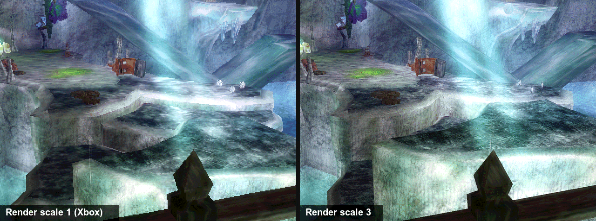
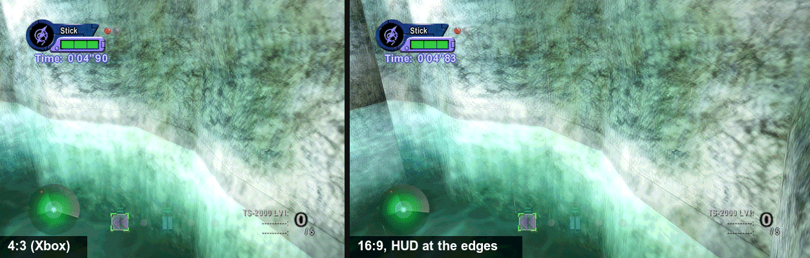
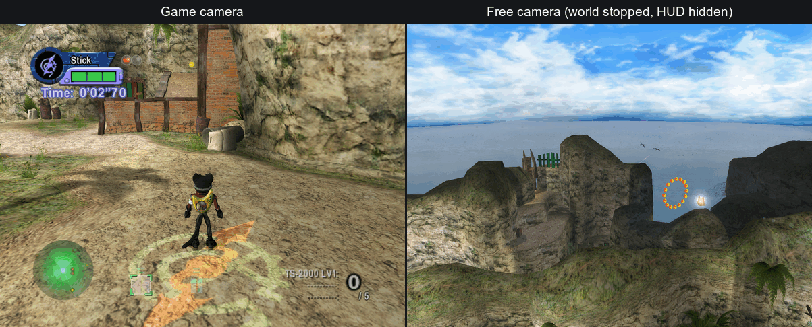
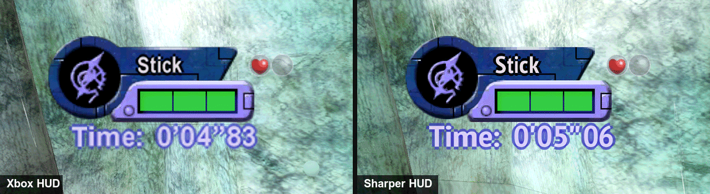

# Playing BLiNX 2

The long version of the [README](../README.md): what the build wizard does
for you, done by hand, and everything you can change once the game runs.
The wizard is still the easy way; start there unless you want the details.

**Contents:** [What you need](#what-you-need) | [Platforms](#platforms) |
[Build the game](#build-the-game) (by hand, install, saves, controls) |
[Options](#options) (widescreen, free camera) |
[HUD texture pack](#hud-texture-pack) | [Known issues](#known-issues) |
[Troubleshooting](#troubleshooting) | [Reporting a bug](#reporting-a-bug-or-a-crash)

## What you need

| Item | Why |
|---|---|
| Your own, legally obtained copy of BLiNX 2: a disc image (`.iso`) or the extracted folder with `default.xbe` | The game's code and assets come from it. This project does not provide or link to them, and refuses other titles. |
| A build machine: a Mac (Apple silicon), a Linux PC or a Windows PC, with about 15 GB free | The bundle is built from your dump on your machine. A Mac can build every target; Linux and Windows build the Windows and SteamOS bundles. |
| [uv](https://docs.astral.sh/uv/getting-started/installation/), git and Python 3.9 or newer | `./blinx2` fetches everything else (CMake, Ninja, the compiler, the toolkit), each download checked against a pinned sha256; it uses git to fetch the toolchain. **macOS:** `brew install uv`; git and Python come with the Command Line Tools (`xcode-select --install`). **Linux:** `curl -LsSf https://astral.sh/uv/install.sh \| sh`; git and Python from your distribution. **Windows:** `winget install --id=astral-sh.uv -e` (uv only), [Git for Windows](https://git-scm.com/download/win), and Python 3.9 or newer from [python.org](https://www.python.org/downloads/windows/) with the `py` launcher. |
| A controller, or the keyboard | Any Xbox, PlayStation or other SDL-supported pad is player 1; the keyboard works too. |

## Platforms

| You play on | Bundle | Graphics | Audio | Input | Status |
|---|---|---|---|---|---|
| Steam Deck (stock SteamOS), or a Linux gaming PC | `steamos` (the Windows build, run under Proton through `umu-run`) | Direct3D 11 (DXVK) | XAudio2 (FAudio) | Controller (XInput) and keyboard | Plays with sound and saves. The Deck is the regular manual test machine. Set the Steam entry's Game Resolution to Native (1280x800) so Steam does not rescale the game, then set `scale = 2`, or leave it at 1 and rely on FSR; `aspect = "16:10"` fills the Deck's screen. |
| Linux desktop with Proton | `steamos`, or the bare build under `umu-run` | Direct3D 11 (DXVK) | XAudio2 (FAudio) | Controller and keyboard | Plays; this is the tested Linux route (GE-Proton 11). Window resize does not reach the game there; fullscreen does. |
| macOS (Apple silicon) | `macos` (`.dmg`) | Metal | SDL2 (CoreAudio) | Controller (SDL GameController) and keyboard | Plays with sound and saves. |
| Windows x86-64 | `windows` (a setup program) | Direct3D 11 | XAudio2 | Controller (XInput) and keyboard | Plays with sound and saves; the golden scenarios are checked against reference frames on native Windows too. |

The game runs at 30 frames per second and 4:3, as on the Xbox. Widescreen
is opt-in (Hor+, see [Options](#options)); at 4:3 a wide window or screen is
pillarboxed, never stretched. A 60 fps mode is not planned (the stage logic
steps a fixed 1/30 s, so a faster loop plays at double speed). External
frame-generation tools (Lossless Scaling, lsfg-vk, AMD AFMF, NVIDIA Smooth
Motion) can show it at 60; they are unsupported, see
[docs/frame-generation.md](frame-generation.md).

Every stage and boss has been reached in scripted runs; the title, attract
mode, stage 1 and the story route to the hub are checked frame by frame
against reference frames on every build, on Metal and on Direct3D 11.

**Sister project.** [Burnout 3: Takedown](https://github.com/apexJCL/burnout3-recomp)
is recompiled with the same toolkit and build wizard, as a fork of
[sp00nz's project](https://github.com/sp00nznet/burnout3); its README has its
own platforms table and [releases](https://github.com/apexJCL/burnout3-recomp/releases),
so you can compare how far each game has come. Neither repository publishes
game files, frames, audio or saves.

## Build the game

**The short route: the build wizard.** From the release that carries it on,
each [release](https://github.com/apexJCL/blinx2-recomp/releases) has a
small program for Windows, macOS and Linux (Steam Deck included): download
yours, point it at your disc image, pick the options, and it builds and
installs the game for you. It runs the same commands as below.
[docs/packaging.md](packaging.md#the-wizard) has the steps, the
SmartScreen and Gatekeeper prompts, and where it puts things.

**By hand.** Get this project, then go into its folder (one line at a time, in Terminal
on macOS and Linux or in PowerShell on Windows):

```sh
git clone https://github.com/apexJCL/blinx2-recomp.git
cd blinx2-recomp
```

Then give it your disc image, or the folder with `default.xbe`:

```sh
./blinx2 /path/to/your/BLiNX2.iso
```

In PowerShell that is `.\blinx2 C:\path\to\BLiNX2.iso` (`blinx2
C:\path\to\BLiNX2.iso` in the Command Prompt). On Windows, keep the path
short (`C:\b2`) and run `git config --global core.longpaths true` once
before the clone.

It checks that the disc is BLiNX 2, puts its files in `game_files/` in this
folder (git ignores it), fetches the toolchain, lifts the game and builds a
bundle for this computer: macos on a Mac, steamos on Linux, windows on
Windows. The first run takes a while (between about 20 and 40 minutes in the
runs timed so far); later runs only rebuild what changed. The bundle lands in
`dist/`. You can also copy the disc's files into `game_files/` yourself and
run `./blinx2` alone.

```sh
./blinx2 package windows|steamos|macos   # the same, for another target
./blinx2 doctor      # what this machine has, what it can package, and what to install first
```

Copy the bundle to the machine you play on (a USB stick, `scp`, a share) and
install it there:

| Target | Install | Saves, settings and logs |
|---|---|---|
| **Steam Deck / Linux** (`dist/BLiNX2-<v>-steamos.tar`) | In Desktop Mode: `tar -xf BLiNX2-<v>-steamos.tar`, `cd BLiNX2-<v>-steamos`, `./install.sh --steam` (Steam open: it adds "BLiNX2" as a non-Steam game). A stock Deck has no `umu-run`; the installer offers to download the pinned umu-launcher (1.4.4), or run `./install.sh --fetch-umu`. The first launch downloads the Steam Linux Runtime and GE-Proton and makes the Wine prefix, which takes a few minutes. In Game Mode, set the entry's Properties > General > Game Resolution to Native (1280x800). Later versions: `./install.sh`; `./install.sh rollback` goes back one. | `~/Games/BLiNX2/{hdd,config,logs}` |
| **macOS** (`dist/BLiNX2-<v>.dmg`) | Open the `.dmg` and drag `BLiNX2.app` to Applications (replace the old one to update). The app is signed ad hoc, not notarized: on another Mac, right-click > Open once, or `xattr -dr com.apple.quarantine /Applications/BLiNX2.app`. | `~/Library/Application Support/BLiNX2/{hdd,config,logs}` |
| **Windows** (`dist/BLiNX2-<v>-windows/`) | Keep the folder together (the setup reads `game_files\` beside it) and run `BLiNX2-<v>-setup.exe`. It installs for your user only, no administrator rights, with a Start Menu entry. SmartScreen will warn (unsigned, built on your machine): More info > Run anyway. A newer setup installs on top. | `%LOCALAPPDATA%\BLiNX2\{hdd,config,logs}` |

Saves (`hdd/`), settings (`config/`) and logs (`logs/`) live outside the
program files and survive every update, rollback and uninstall.
[docs/packaging.md](packaging.md) has the long version: every installer
option, updating, uninstalling, moving saves (the menu's Saves page) and a
troubleshooting list.

**Updating to a new release.** Run the new release's wizard on the same
build folder, or by hand `git pull` and then `./blinx2` in this folder.
Either way the toolchain moves to the new release's pins before the build;
then install the new bundle as above.

**A bundle is private.** It contains your copy of the game and code generated
from it. Keep it on your own machines; never share, upload or publish it.

### Bring your saves

Saves from a console, another install or another PC import into the save
folder of the table above:

```sh
./blinx2 saves list --from PATH          # what PATH holds, and what would import
./blinx2 saves import --from PATH --dry-run
./blinx2 saves import --from PATH        # add --replace to overwrite a save already there
```

`PATH` is a folder or a zip: another install's `hdd` folder, a console's
`E:` copy (from a dashboard or FTP), a `UDATA` folder or one title folder
(`4d530065`), or a zip of any of those, including the menu's Saves export.
Saves need no console keys: each import re-signs `blinx2data.bin` for this
build. Close the game first; the import refuses while it runs. Before the
first write it zips the saves already there to
`config/exports/save-backups/`, beside the menu's own Saves backups, and it
never overwrites a save unless you pass `--replace`. Add
`--to <data folder>/hdd` when the game is installed on another machine or
in another place. Disc images (xemu qcow2, raw disks, memory units) come
later; copy the saves out with xemu or a FATX tool until then.

### Controls

A controller is player 1. The keyboard and the mouse are merged onto
player 1 while the game window has the focus. Focusing the window grabs the
mouse; `F9` frees the cursor and grabs it again. Change a key under
`[input.bindings]` in `config/config.toml`; [docs/input.md](input.md)
has the names, examples and the mouse settings.

| Keys and mouse | Xbox control | Keys and mouse | Xbox control |
|---|---|---|---|
| W/S/A/D (or numpad 8/2/4/6) | Left stick (move) | Mouse, or I/K/J/L | Right stick (look) |
| Arrows | D-pad | Space | A (jump) |
| Left click or R | Right trigger (sweep, shoot) | Right click or F | B (action) |
| E | X (time control) | Q | Y |
| C, Z | White, Black | Left Shift | Left trigger |
| Tab, middle click | Left, right stick click | | |
| Enter or Escape | START (pause) | Backspace | BACK |
| Left Alt (hold) | walk | F9 | free the cursor |

## Options

The game runs stock by default. Enhancements are opt-in. Every option and
its default is in `config.default.toml`, which ships beside the game (in
`Contents/Resources` in the macOS app) and is replaced by each update. Your
changes go in `config/config.toml` in the data folder above: it holds only
the keys you set, wins over the defaults, and no update touches it (the
first launch writes it as a comment header, and renames a
`config/enhance.toml` from an earlier version). Each key can also be set as
an environment variable, which wins over both files; `config/launch.env`
takes `KEY=value` lines for any `RECOMP_*` variable.

| Option | `config.toml` key | Environment variable | Values (default first) | What it does |
|---|---|---|---|---|
| Render scale | `render.scale` | `RECOMP_RENDER_SCALE` | `1`, `2`, `3`, `4` | Draws the 3D at a multiple of the stock 640x480. Metal and Direct3D 11; the CPU renderer ignores it. |
| Anisotropic filtering | `render.aniso` | `RECOMP_RENDER_ANISO` | `0` (off), `2` to `16` | Sharper ground and walls seen at a slant. A small change in this game, most visible at render scale 1. Metal and Direct3D 11. |
| Aspect | `display.aspect` | `RECOMP_DISPLAY_ASPECT` | `"4:3"`, `"16:9"`, `"16:10"`, `"21:9"` or another wider `"W:H"` | Hor+ widescreen: a wider aspect shows more of the world at the sides instead of stretching it, see [below](#widescreen). The HUD moves to the edges (the HUD mod below). Metal and Direct3D 11. |
| Movies in widescreen | `display.movie` | `RECOMP_DISPLAY_MOVIE` | `"fill"`, `"black"`, `"fit"` | With a wide aspect, how the movies fill the frame: scaled to cover it (top and bottom cropped, so the title movie fills the width), pillarboxed, or stretched to the width. Nothing at 4:3. |
| HUD at the edges | `mods."hud.enable"` | `RECOMP_HUD` | `"on"`, `"off"` | On by default. With a wide aspect, the radar, the time panel and the counters move out to the screen's edges, as on a 4:3 TV; menus, dialogue and the pause panel stay centred. `display.hud_aspect` and `display.hud_margin` set where the edges are. Nothing at 4:3. Also on the menu's Mods page. Metal and Direct3D 11. |
| Overscan | `display.overscan` | `RECOMP_DISPLAY_OVERSCAN` | `0` to `64` | Crops this many pixels of the 640-wide frame from the left and right edges (top and bottom in proportion, so it stays 4:3) and zooms the rest. BLiNX 2 needs none; ignored with a wide aspect. Metal and Direct3D 11. |
| Fullscreen | `present.fullscreen` | `RECOMP_PRESENT_FULLSCREEN` | `false`, `true` | Opens the window borderless fullscreen (no mode change). |
| Scaling filter | `present.filter` | `RECOMP_PRESENT_FILTER` | `"nearest"`, `"linear"`, `"integer"` | How the 4:3 frame fills the window: letterboxed nearest, letterboxed bilinear, or the largest whole multiple that fits, centred. |
| Frame pacing | `present.pacing` | `RECOMP_PRESENT_PACING` | `"sleep"`, `"spin"` | `sleep` lets the game's frame wait sleep until the next vblank: less heat and battery, the same frames; the default on every non-Windows build (macOS). `spin` is the console-original timing, where the wait holds a CPU core as it did on the Xbox; the default on Windows and on a Deck, since native Windows stalled some file reads at `sleep`. Either works on every build. |
| Shader | `present.shader` | `RECOMP_PRESENT_SHADER` | `"none"`, `"crt-lottes"`, `"crt-lottes-fast"`, `"crt-hyllian"`, `"fsr"`, a `.slangp` path | A CRT look (shadow mask, scanlines) on the final picture, run by librashader on Metal and Direct3D 11; `fsr` is AMD's upscaler instead. Also on the menu's Shaders page, with the preset's settings (`present.shader_params`). Nothing extra to install: on Windows the bundle ships a build that needs no Visual C++ runtime or D3DX9. Without the library the game says so in its log and looks stock. |
| Shader profile | `present.profile` | `RECOMP_PRESENT_PROFILE` | `"none"`, a profile name | A chain of up to 8 shaders with their settings, built and saved on the menu's Shaders page (*Add shader*, then Save) as `config/shader-profiles/<name>.toml`, for example `fsr` then `crt-lottes`. When set it wins over `present.shader`. |
| Present surface | `present.surface` | `RECOMP_PRESENT_SURFACE` | `"auto"`, `"window"`, `"internal"` | `internal` hands the compositor the frame at its own size to scale (gamescope's FSR on a Deck needs it, at `scale = 1`); `window` draws at the window's size. `auto` picks `internal` under the SteamOS launcher in gamescope, `window` elsewhere. |
| HUD texture pack | `textures.pack` | `RECOMP_TEXTURES_PACK` | none, a path | Your own 4x HUD and font pack, see [below](#hud-texture-pack). A relative path is taken from the executable's folder. |
| Bloom | `fx.glow`, `fx.glow_intensity` | `RECOMP_GLOW`, `RECOMP_GLOW_INTENSITY` | `"on"`/`"off"`; `1.0` (0.0 to 2.0) | Turns the game's bloom (screen glow) pass off, or scales it. |
| Free camera | `camera.free` and `camera.free_*` | `RECOMP_CAMERA_FREE` and `RECOMP_CAMERA_FREE_*` | `"off"`, `"on"` | F6 (or Guide+Y, or Back+R3 held 0.4 s) starts and stops a camera you fly anywhere in the stage while Blinx stands still: left stick moves, right stick or mouse looks, RT/X up, LT/Y down, White fast, Black slow. F7 hides the HUD, End stops the world, Home goes back to the game's camera. Speed, look and mouse sensitivity, the fast and slow multipliers and both inverts are on the menu's Mods page and in `config.default.toml`; the keys are under `[input.actions]`. Metal and Direct3D 11; see [below](#free-camera). |
| In-game menu | `menu.enabled` | `RECOMP_MENU` | `true`, `false` | On by default. F10 (or Guide+A, an Elite's P1, or Back+L3 held 0.4 s) opens a menu over the game to change these options while it runs, rebind the host actions and turn mods on or off; Save keeps only what you changed in `config/config.toml`. The game keeps running behind it and sees no input. |
| Stats strip | `overlay.stats` | `RECOMP_OVERLAY_STATS` | `false`, `true` | fps, frame time, pacing, scale and backend in the window's corner; F3 (while the menu is on) or the menu's Stats page toggles it while you play. |
| Window size | (none) | `RECOMP_WINDOW_SCALE` | `2` | Initial window size, 640x480 times this (the SDL window on macOS). |
| Frame rate | `fps.mode` | `RECOMP_FPS_MODE` | `"lock30"` only | `lock60` and `free` are reported as not available (see [Platforms](#platforms)); for a 60 fps look, see [external frame generation](frame-generation.md). |

```toml
# config/config.toml, for example
[render]
scale = 2

[present]
fullscreen = true
pacing = "spin"

[fx]
glow = "off"
```

Render scale 1 (stock) and 3 at the same moment of stage 3 (Direct3D 11 on
Windows, 16:9; stock behaviour and the automated checks stay at 1x):



### Widescreen

`aspect = "16:9"` (or `"16:10"`, `"21:9"`) widens the view instead of
stretching it: the game keeps its vertical field of view and draws more of
the stage at the sides (Hor+). The HUD mod moves the radar, the time panel
and the counters to the edges, menus and dialogue stay centred, and the
movies fill the width (`display.movie`). The pair is the same moment of stage
3 at 4:3 and at 16:9 (Direct3D 11 on Windows, render scale 3):



```toml
[display]
aspect = "16:9"
```

### Free camera

With `camera.free = "on"` (or Free camera on the menu's Mods page), F6,
Guide+Y or Back+R3 held 0.4 s (Back first; for pads whose Guide the game
never sees, as on the Deck) detaches the camera from Blinx and lets you fly it anywhere in the
stage; End stops the world and F7 hides the HUD, for a clean shot, and Home
puts the camera back on the game's.

| Control | Default |
|---|---|
| Toggle flight | F6, Guide+Y, Back+R3 held 0.4 s |
| Toggle HUD, Freeze game, Reset camera | F7, End, Home (while flying) |
| Move, look | left stick, right stick or the mouse |
| Rise, sink | RT or X, LT or Y |
| Fast, slow | White, Black |

The four keys are host actions (`camera.free.toggle`, `.hud`, `.freeze`,
`.reset` under `[input.actions]`), rebound on the menu's Controls page or the
camera's Mods page. The old `camera.free_toggle`, `_hud_key`, `_freeze_key`
and `_reset_key` keys are still read.



## HUD texture pack

At render scale 2 or 3 the 3D is sharp, but the HUD, menus and font are
still the game's own small textures, stretched. A HUD texture pack replaces
them with versions at 4x: an xBR upscale of the HUD art, and the Latin font
redrawn from PT Sans Narrow Bold, glyph by glyph in the stock layout. The
Mission Objectives screen's pre-rendered text is in the pack too; the
mission summary (results) text and languages other than US English are not
yet, and stay stock. The pair shows the same stage 1 HUD without and with
the pack, from the Metal backend at render scale 2 in a window at twice the
stock size (1:1 crops; the timers differ because they are two runs).



The pack is optional and off by default. No pack is distributed: you make
your own from your own game files, and it stays on your machines like the
game. On Linux and Windows install PT Sans Narrow (ParaType; a Google Fonts
family) for your user first; macOS ships it. Build the game first
(`./blinx2 /path/to/your/BLiNX2.iso`, above), then make the pack and package
with it:

```sh
./blinx2 enhance hud                   # writes dist/enhance/hud/hud.pack (--font FILE for another font file)
./blinx2 package macos --hud-pack      # or windows, steamos: puts the pack in the bundle and turns it on
```

`--hud-pack` turns the pack on in the bundle's `config.default.toml`, so
it is on after a first install and after an upgrade alike. For the stock
HUD, put this in your `config/config.toml`:

```toml
[textures]
pack = "none"
```

At start the log says `[ENHANCE] textures.pack=<path> (<n> entries, scale
4)`, and every 600 flips `[metal] textures.pack: N hits so far` (`[d3d11]`
on Direct3D 11) counts the textures drawn from the pack. Metal and
Direct3D 11 draw the pack; the CPU renderer ignores it, and the automated
checks never use one. `./blinx2 enhance hud --help` lists the options
(`--scale 2|4`, `--only PATTERN`, `--list`).

## Known issues

| Issue | Where | State |
|---|---|---|
| The game can crash in stage 5-1 after about 90 s (seen once, in a scripted run) | macOS | Being investigated. |
| Resizing the window by hand does not reach the game | Linux/Proton (GE-Proton 11, KWin) | Fullscreen and render scale work; use them instead. |
| Bump-environment mapping (the stage 1 ocean, the Boss 3 ripple) draws as a plain texture | CPU renderer | Metal and Direct3D 11 draw it. |
| A few boss-stage artefacts: sky wedges in Boss 1, shadow shapes in two later bosses | All backends alike | Still being checked against the original hardware; they may be the game's own. |
| Movies: audio-to-video drift has not been measured | All | The game's own Sofdec decoder plays them. |

Fixed in current builds, and verified on the Steam Deck: the freeze on the
results screen after mission 1 and after the mission 3 boss, dark ground and
water on multi-core PCs, and the stage 1 wading stutter.

## Troubleshooting

Quick fixes for the usual symptoms:

| Symptom | Fix |
|---|---|
| "Files are missing", or music, voices or a movie are missing, or the game says the disc is dirty | Your `game_files/` is incomplete: the game's log names each missing file on a `[FILE] missing` line. Import the disc again with `./blinx2 import /path/to/BLiNX2.iso --replace` (`import --check` lists what differs first), then rebuild with `./blinx2`. |
| No sound | Audio is on by default. Check that `config/launch.env` does not set `RECOMP_AC97_READY=0`, and that `SDL_AUDIODRIVER` is not `dummy`. |
| The keyboard does nothing | The game window must have the focus, `input.keyboard` must not be `false` in `config/config.toml`, and `RECOMP_KEYBOARD` must not be `0`. |
| The mouse does nothing | Click in the game window or focus it to grab the cursor (`input.mouse_capture`), or press `F9` if you freed it; `input.mouse` must not be `false` and `RECOMP_MOUSE` must not be `0`. |
| Steam Deck: "umu-run is not installed" | In Desktop Mode, run `./install.sh --fetch-umu` from the unpacked bundle. |
| Steam Deck: the first launch shows only a notice for a few minutes | It is downloading the runtime and Proton; `~/Games/BLiNX2/logs/umu.log` shows the progress. The notice closes when the game starts. |
| macOS: "the app is damaged" or cannot be opened | Gatekeeper: right-click > Open once, or `xattr -dr com.apple.quarantine /Applications/BLiNX2.app`. |

## Reporting a bug or a crash

[Open a bug report](https://github.com/apexJCL/blinx2-recomp/issues/new?template=bug_report.yml).
The form asks for your copy of the game, the build version, where you play,
your settings and the logs; the logs are in the data folder of the
[install table](#build-the-game). Never attach your game files, a save or
the bundle itself.

If the game crashes or does not start:

1. Note what you saw: an error box (its text or a screenshot), the window
   closing, or nothing at all. Add your GPU, its driver version and your
   OS version.
2. Attach the newest `logs/game-*.log` and `logs/xbox_kernel.log` from the
   data folder. The kernel log is rewritten on every launch, so copy it
   before starting the game again. An empty `logs/` is worth saying too.
3. Attach the system's crash record:
   - Windows: in PowerShell, run
     `Get-WinEvent -FilterHashtable @{LogName='Application'; ProviderName='Application Error'} -MaxEvents 3 | Format-List TimeCreated,Message`
     and paste what it prints.
   - macOS: the newest `cat_recomp-*.ips` in `~/Library/Logs/DiagnosticReports/`.
   - Steam Deck or Linux: also `logs/umu.log`.
4. If asked, run once more with extra logging: put these two lines in
   `config/launch.env` in the data folder (on Windows, check the file does
   not end in `.txt`), start the game the usual way and attach the new
   `game-*.log` and `xbox_kernel.log`.
   ```ini
   RECOMP_LOG_LEVEL=3
   RECOMP_TRACE=missing=all,flip,stub
   ```
   They only add log lines; delete the file afterwards.

[docs/packaging.md](packaging.md#reporting-a-crash) has the details.

---
